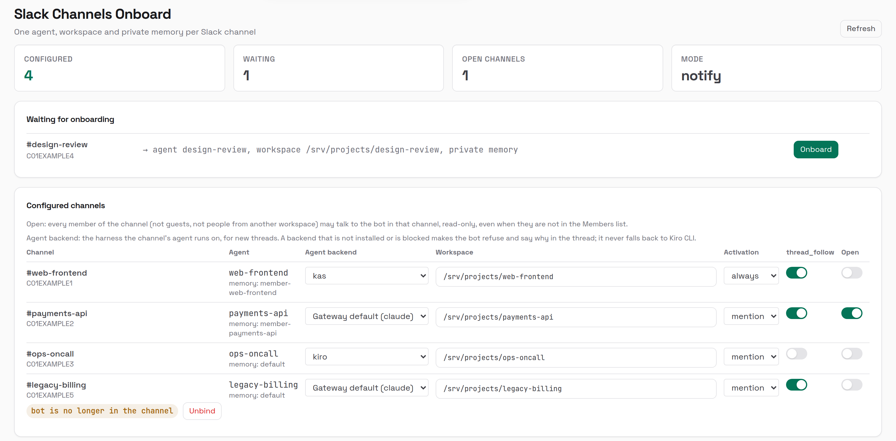

# Slack Channels Onboard

A [Kiro Crew](https://github.com/kirodotdev/KiroCrew) app that gives every Slack
channel its own agent bundle: an agent (`kiro_agent: kirocrew`), a workspace
directory, a private memory store, and the `slack.channels.<id>` binding that
routes the channel to it.

<picture>
  <source media="(prefers-color-scheme: dark)" srcset="assets/screenshots/overview-dark.png">
  
</picture>

<sub>Sample data: every channel, person and path shown is made up.</sub>

## What it does

- **Detects** channels the bot is a member of that have no binding yet (polls
  `users.conversations` every `poll_secs`, default 300 s).
- **Onboards** them according to `mode`:
  - `auto`: create the bundle immediately, then DM the owner what was created;
  - `notify`: DM the owner once that the channel is waiting;
  - `off`: no background work; the page still works.
- **Guard:** with `require_owner_member` (default on) it only acts on channels the
  owner is also in, so someone who can merely invite the bot cannot make the
  gateway create agents.
- **Dashboard page** (sidebar → *Slack Channels Onboard*): one-click Onboard for
  waiting channels; edit the workspace directory (must already exist, e.g. an
  existing repo), activation and `thread_follow` of onboarded ones; edit the
  detector settings.
- **Unbind** a channel the bot has left: removes only its `slack.channels`
  binding (and its roles entry). Refused while the bot is still in the channel or
  when Slack cannot be read. The agent, workspace and memory are kept.

Every write is recorded in the SEL audit log (`slack_channels_onboard.*`).

## People (members and maintainers)

Stock Kiro Crew lets **only the owner** use the bot on Slack. On such a gateway
this section of the page is shown read-only with an explanation, and its API
routes answer `409`, because a role the gateway does not enforce would only look
like access control.

On a gateway that enforces per-user Slack access, the app detects each control
separately (by the function the gateway exposes, never by version) and enables
only those:

| Control | Stored in | Meaning |
|---|---|---|
| Members | `slack.allowed_users` in `config.json` | May talk to the bot, read-only |
| Maintainers per channel | `<data home>/channel-roles.json` → `channels.<C>.maintainers` | Write access inside that channel's workspace |
| Approved commands / programs | same file → `commands`, `programs` | Run without an approval prompt |
| Open channel | same file → `open: true` | Every human member of that channel may talk there, read-only |
| Workspace confinement | — | The channel's agent process runs in an OS sandbox; maintainers get full power inside the workspace |

The roles file is written atomically with mode 600. User IDs are checked against
Slack (`users:read`), so bots and deactivated accounts are refused.

These controls exist only on a gateway carrying the patch sets in
[`gateway-patches/`](gateway-patches/README.md). Read that page before applying
them: they change who may use the bot, target Kiro Crew 0.9.0, and must be
re-applied after every Kiro Crew update.

## Agent backend per channel

On a gateway that reads `agents.<name>.acp_backend` (upstream issue
kirodotdev/KiroCrew#21910), the channel table gets an **Agent backend** column:
the harness the channel's agent runs on (kiro, kas, claude, …). The column is
hidden on a gateway without the field, detected the same way as the People
controls. Until upstream ships the field, Set U in
[`gateway-patches/`](gateway-patches/README.md) adds it.

- The pin lives on the **agent**, so every channel bound to that agent moves with
  it. *Gateway default* removes the pin (`agent.acp_backend` applies); *kiro*
  stores `""`.
- Only a backend the gateway allows and that is installed on the host can be
  picked. A change applies to **new** threads. A running thread keeps its harness
  until its agent process restarts (a gateway restart, for one); it then starts a
  fresh session on the new backend, without the old session's context.
- Whether an unusable pin is refused (with the reason posted in the thread) or
  falls back to kiro-cli is the gateway's behaviour; the page says which.

## How it writes

The backend runs as in-gateway hooks (`backend.hooks`), not a separate process,
and reuses the gateway's own code paths:

- config edits: `config.loader.update_config_locked` plus the Slack handler's
  config reload (`slack.channels` is live-applied, no restart);
- a new agent with private memory: the same sequence as `POST /api/agents`
  (`provision_member_memory` + `persist_member_config`, with rollback of an
  unpublished allocation);
- the channel binding is written last, so a failure never leaves a channel bound
  to a half-created agent.

All routes are owner-only (`require_owner_dashboard_request`). The Slack bot
token is read from the gateway credential store at call time and is never logged
or returned.

## Requirements

- Kiro Crew **0.9.0** or newer, with Slack connected.
- Slack bot scopes: `channels:read`, `groups:read`, `users:read`, `chat:write`
  (DMs to the owner) and `im:write`.
- This app runs Python inside the gateway, so the operator must allow third-party
  app code: set `agent.apps_allow_third_party` to `true` in `config.json`.
  Without it the install reports `app_execution_denied`.

## Install

From the App Store (Apps → Discover), or from a local clone:

```bash
git clone https://github.com/mvn-bachhuynh-dn/slack-channels-onboard
kirocrew app install ./slack-channels-onboard
kirocrew app enable slack-channels-onboard
```

## Caveats

- In-gateway Python runs with full gateway privileges (the gateway logs a
  `SECURITY: executing third-party app` warning). Only install it if you trust it.
- It imports Kiro Crew internals, so a Kiro Crew update can break it. After an
  update, check the gateway log for `slack-channels-onboard` errors.
- Deleting an onboarded agent from the dashboard leaves its private memory store
  on disk (gateway behaviour); there is no store purge API.

## Develop

```bash
cd ui && npm ci && npm run build && rm -rf node_modules && cd ..   # ui/dist is committed
python -m pytest tests -q                                          # backend unit tests, no gateway needed
```

The UI is in English and switches to Vietnamese when the browser asks for it
(`ui/src/i18n.ts`).

## License

Apache-2.0
